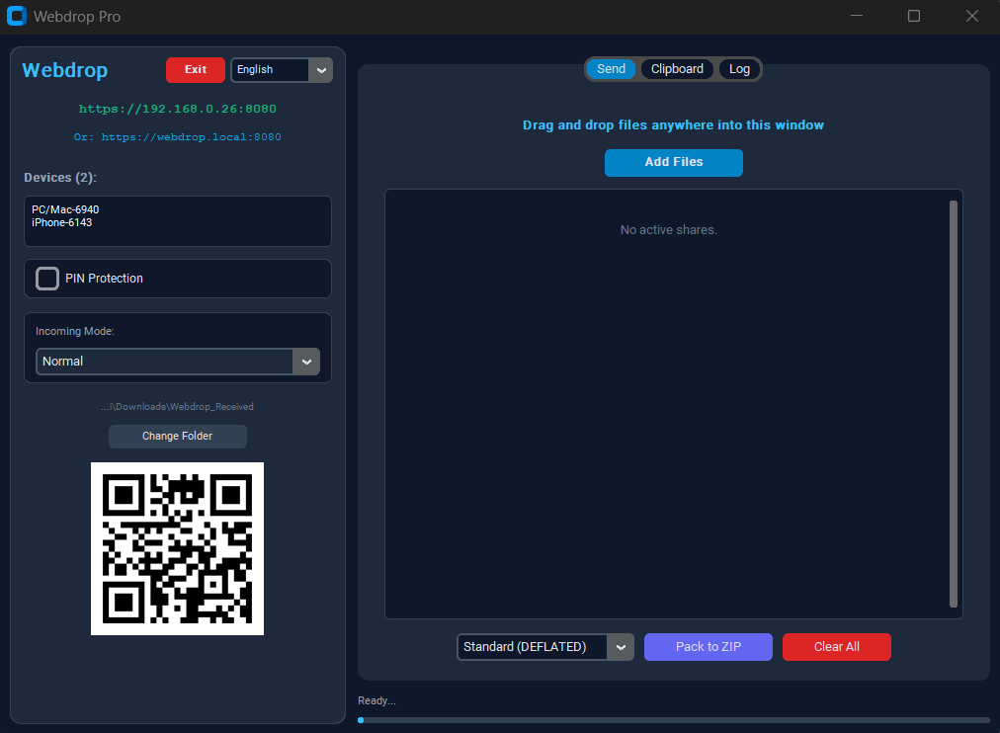
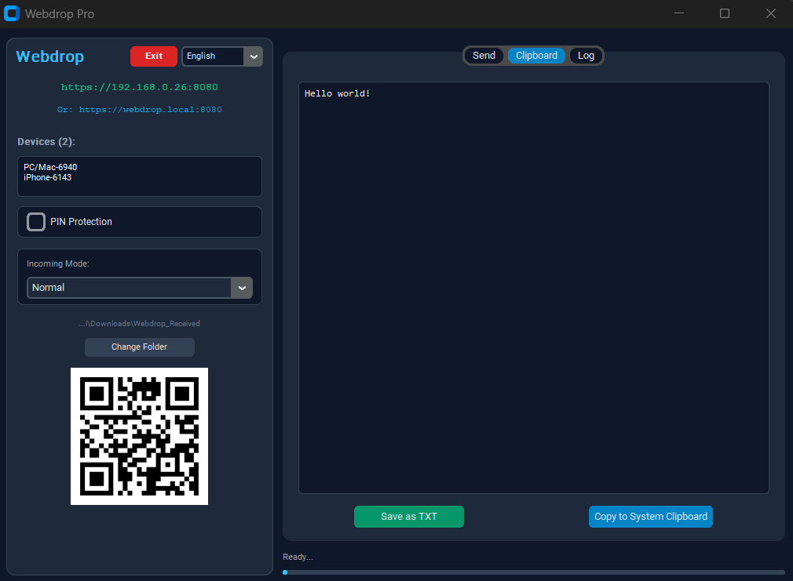
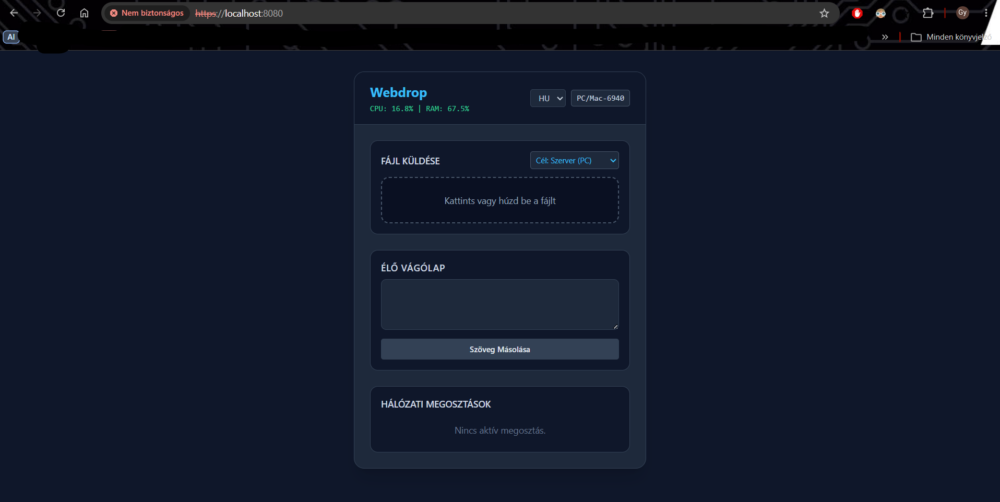
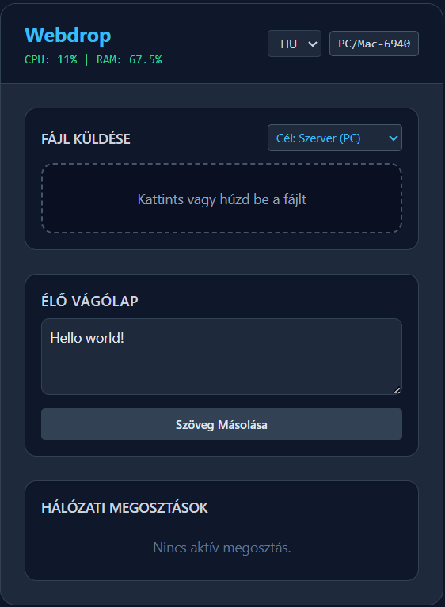
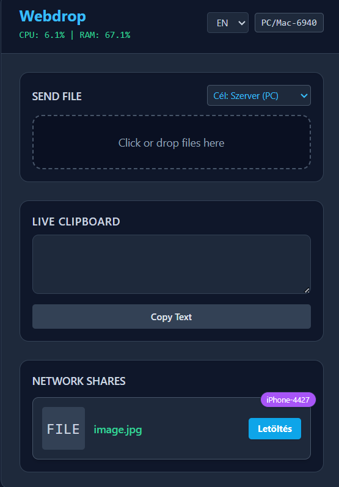
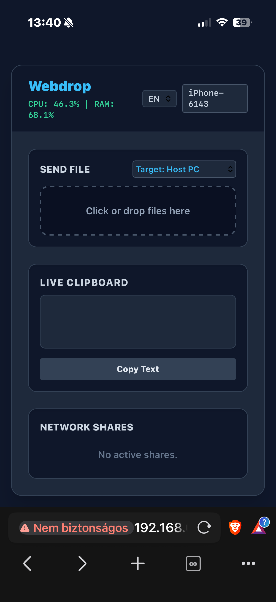
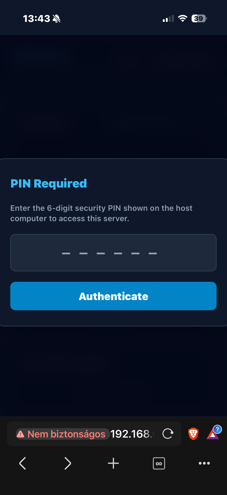

<div align="center">

# 🌐 Local Webdrop

**High-performance, zero-cloud LAN data transmission & live clipboard bridge.**

[](https://www.python.org/)
[](https://fastapi.tiangolo.com/)
[](https://github.com/Gyuri125/local-webdrop)
[](https://github.com/Gyuri125/local-webdrop)
[](https://github.com/Gyuri125/local-webdrop)
[](LICENSE)

[English](#-key-features) • [Telepítés és Használat (Magyar)](#-magyar-nyelvű-összefoglaló) • [Screenshots](#-interface-preview) • [Architecture](#-system-architecture)

---

</div>

**Local Webdrop** is an open-source, zero-configuration local transmission engine engineered for secure Local Area Network (LAN) operations. It creates an encrypted bridge between your desktop workstation and any mobile, tablet, or web client. Enjoy lightning-fast chunked file transfers, instant in-browser media streaming, and bidirectional live clipboard synchronization—completely offline, without third-party servers, cloud trackers, or internet access required.

---

## 📑 Table of Contents

- [Interface Preview](#-interface-preview)
- [Key Features](#-key-features)
- [System Architecture](#-system-architecture)
- [Multi-Monitor & DPI Virtualization](#-multi-monitor--dpi-virtualization)
- [Keyboard Shortcuts](#-keyboard-shortcuts)
- [Tech Stack](#-tech-stack)
- [Getting Started](#-getting-started)
  - [Prerequisites](#prerequisites)
  - [Installation](#installation)
  - [Running the Application](#running-the-application)
- [Connecting Client Devices](#-connecting-client-devices)
- [Project Structure](#-project-structure)
- [Magyar Nyelvű Összefoglaló](#-magyar-nyelvű-összefoglaló)
- [License](#-license)

---

## 📸 Interface Preview

### Desktop Controller
| Main Workspace & Discovery | Synchronized Live Clipboard |
| :---: | :---: |
| <a href="docs/screenshots/desktop_main.png"></a> | <a href="docs/screenshots/desktop_clipboard.png"></a> |

### Web Client (Desktop Viewport)
| Dashboard Overview | Live Clipboard | Active Transfers & Relay |
| :---: | :---: | :---: |
| <a href="docs/screenshots/web_main.png"></a> | <a href="docs/screenshots/web_clipboard.png"></a> | <a href="docs/screenshots/web_transfer.png"></a> |

### Mobile Client & Security Workflow
| Mobile Responsive Viewport | 6-Digit PIN Authentication Challenge |
| :---: | :---: |
| <a href="docs/screenshots/mobile_main.png"></a> | <a href="docs/screenshots/mobile_auth.png"></a> |

---

## ✨ Key Features

- **🔒 Complete Local Subnet Isolation**: All communication stays strictly inside your local broadcast domain. No external telemetry, no remote relay servers, and zero cloud footprint.
- **🛡️ Auto-Configured TLS/HTTPS Encryption**: Communications (REST & WebSockets) are encrypted via TLS. Self-signed X.509 certificates and RSA keys are automatically generated on first launch—no manual OpenSSL setup needed!
- **⚡ Chunked Streaming with Speedometer & ETA**: Large files are processed asynchronously in 5 MB stream buffers with paused/interrupted transfer recovery, automated retry on connection blips, real-time MB/s throughput metering, ETA calculation, and one-click cancellation.
- **📦 One-Click "Download All (ZIP)"**: Download all shared files simultaneously from mobile or web clients packaged on-the-fly into a clean ZIP archive with automatic temporary background cleanup.
- **💾 Storage Guard & Host Monitoring**: Proactive disk space checks prevent filling the host storage (HTTP 507 Insufficient Storage), paired with real-time CPU, RAM, and free GB monitoring on client devices.
- **📋 Bidirectional Live Clipboard & Image Paste**: Seamlessly mirror clipboard text between desktop and mobile devices in real time over WebSockets, plus direct `Ctrl+V` screenshot and image pasting onto the web interface.
- **🎬 In-Browser Byte-Range Media Streaming**: Instant audio and video playback directly inside client web browsers using HTTP Range requests without waiting for the full file download.
- **🔍 Zero-Config Local Discovery**: Multicast DNS (mDNS / Zeroconf) advertises the service as `https://webdrop.local:8080`, paired with an interactive dynamic QR code on the desktop window for instant phone scanning.
- **📱 Zero App Installation for Clients**: Connecting devices need only a modern web browser. No iOS or Android app installation required.
- **🔑 Tokenized PIN Protection & Anti-Brute Force**: Optional 6-digit dynamic PIN with transient bearer tokens and IP rate limiting (automatic lockouts after consecutive failed attempts).
- **🗜️ Flexible Ingest Modes**: Choose between **Normal** direct download, automated **Timestamp Folders** (`Drop_YYYYMMDD_HHMMSS`), or background **Auto-ZIP** packaging.
- **🔄 Host Relay Pipeline**: Allows transient mobile-to-mobile file handoffs mediated securely through the desktop host.
- **🌍 Built-in Multilingual Localization (i18n)**: Switch dynamically between English, Magyar (Hungarian), Deutsch (German), and Русский (Russian).

---

## 🏗️ System Architecture

```text
+-------------------------------------------------------------------------+
|                              LOCAL NETWORK (LAN)                        |
|                                                                         |
|   +-----------------------+                 +-----------------------+   |
|   |  Mobile Client (iOS)  |                 | Android / Web Browser |   |
|   +-----------+-----------+                 +-----------+-----------+   |
|               |                                         |               |
|       WSS / HTTPS (TLS)                         WSS / HTTPS (TLS)       |
|               |                                         |               |
|               +--------------------+--------------------+               |
|                                    |                                    |
|                                    v                                    |
|   +-----------------------------------------------------------------+   |
|   |                       HOST SERVER RUNTIME                       |   |
|   |                                                                 |   |
|   |  +--------------------+  Token Auth / Rate Limiting             |   |
|   |  |   FastAPI Engine   |<--------------------------+             |   |
|   |  | (Uvicorn / AsyncIO)|                           |             |   |
|   |  +---------+----------+                           |             |   |
|   |            |                                      |             |   |
|   |            v                                      v             |   |
|   |  +--------------------+                +---------------------+  |   |
|   |  |  State Repository  |<-------------->| CustomTkinter / DND |  |   |
|   |  | (In-Memory Buffer) |  Thread-Safe   |  Desktop Workspace  |  |   |
|   |  +--------------------+                +---------------------+  |   |
|   +-----------------------------------------------------------------+   |
+-------------------------------------------------------------------------+
```

---

## 🖥️ Multi-Monitor & DPI Virtualization

The native desktop controller is designed for productivity in modern desktop environments:

- **Per-Monitor DPI Scaling**: UI elements, typography, and QR code vector bitmaps dynamically adapt their scale factor when moved across displays of varying DPI (e.g., 4K primary monitor and standard 1080p secondary monitor).
- **Global Drag-and-Drop Drop Target**: Staging files is effortless—drag and drop files from any monitor directly into the application window (powered by TkinterDnD2).
- **System Tray Minimization**: Closing the window hides the application into the system tray (using `pystray`), preserving active connections, transfers, and clipboard state.

---

## ⌨️ Keyboard Shortcuts

| Shortcut | Scope | Action |
| :--- | :--- | :--- |
| `Ctrl + V` | Desktop Window | Paste system clipboard content directly into the live broadcast buffer |
| `Ctrl + C` | Desktop Staging | Copy selected shared clipboard text into the OS clipboard registry |
| `Ctrl + S` | File Buffer | Trigger background compressor to aggregate shared files into a ZIP archive |
| `Escape` | Web Application | Exit full-screen media player and detach DOM playback instances |
| `Ctrl + Q` | Application | Flush transactions, terminate server loops, and safely release ports |

---

## 🧰 Tech Stack

| Layer | Technologies |
| :--- | :--- |
| **Backend & Engine** | Python 3.10+, FastAPI, Uvicorn, AsyncIO, WebSockets |
| **Security & Cryptography** | `cryptography` (X.509 self-signed certificates, RSA-2048), Token Auth |
| **Discovery & Network** | Zeroconf (mDNS), Python Socket API |
| **Desktop GUI** | CustomTkinter, TkinterDnD2, Pillow (PIL), Pystray, Plyer |
| **Web Frontend** | Vanilla ES6+ JavaScript, Tailwind CSS, HTML5 Media & File APIs |

---

## 🚀 Getting Started

### Prerequisites

- **Python 3.10 or higher** (Python 3.10, 3.11, 3.12, 3.13 supported)
- All communicating devices must be connected to the **same Wi-Fi or local network subnet**

> [!NOTE]
> **Automatic Certificate Generation:** Local Webdrop automatically generates its own TLS certificate (`webdrop_cert.pem`) and private key (`webdrop_key.pem`) on first startup. You do not need to install OpenSSL manually.

### Installation

1. **Clone the repository:**
   ```bash
   git clone https://github.com/Gyuri125/local-webdrop.git
   cd local-webdrop
   ```

2. **Create and activate a virtual environment:**

   * **Windows (PowerShell):**
     ```powershell
     python -m venv .venv
     .\.venv\Scripts\Activate.ps1
     ```

   * **Linux / macOS:**
     ```bash
     python3 -m venv .venv
     source .venv/bin/activate
     ```

3. **Install dependencies:**
   ```bash
   pip install -r requirements.txt
   ```

### Running the Application

Launch the desktop controller and unified background server:

```bash
python main.py
```

---

## 📲 Connecting Client Devices

1. **Scan QR Code or Open URL**:
   - On mobile devices, scan the QR code displayed on the desktop controller.
   - Alternatively, open your browser and navigate to:
     - `https://webdrop.local:8080` (via mDNS)
     - `https://<YOUR-PC-IP>:8080` (e.g. `https://192.168.1.150:8080`)

2. **Accept the Self-Signed Certificate**:
   - Because the certificate is generated locally on your computer for maximum privacy without external Certificate Authorities (CAs), your browser will display a one-time security warning.
   - Click **Advanced** and proceed to the site (e.g., *Proceed to webdrop.local (unsafe)*).

3. **PIN Authentication (If Enabled)**:
   - If PIN protection is enabled in the desktop window, enter the 6-digit PIN shown on your PC screen.

4. **Send & Receive**:
   - Drag and drop files onto the desktop app to share with connected devices.
   - Drop files in the mobile/web browser to upload them straight to your PC's `Downloads/Webdrop_Received` folder.
   - Type or paste into the Live Clipboard to instantly sync text across devices.

---

## 📁 Project Structure

```text
local-webdrop/
├── app/
│   ├── __init__.py
│   ├── gui.py              # CustomTkinter desktop interface & system tray
│   ├── i18n.py             # Multi-language localization dictionary
│   ├── server.py           # FastAPI REST API, WebSocket hub & streaming engine
│   ├── state.py            # Thread-safe in-memory state repository
│   ├── utils.py            # IP resolution, mDNS Zeroconf, TLS cert generation
│   └── templates/
│       └── index.html      # Mobile-first responsive web client (Tailwind CSS)
├── docs/
│   └── screenshots/        # Application interface previews
├── .gitignore              # Clean GitHub ignore configuration
├── LICENSE                 # MIT License
├── main.py                 # Application bootstrapper
├── pyproject.toml          # Project packaging configuration
└── requirements.txt        # Python dependency manifest
```

---

## 🇭🇺 Magyar Nyelvű Összefoglaló

A **Local Webdrop** egy pehelykönnyű, villámgyors és biztonságos helyi hálózati (LAN) adatátviteli eszköz, amely közvetlen kapcsolatot létesít a számítógéped és a telefonod/tableted vagy más gépek között.

### Főbb Jellemzők:
- **Teljes Adatbiztonság**: Az adatok kizárólag a helyi hálózaton mozognak, felhő vagy külső szerverek nélkül.
- **Titkosított Kapcsolat**: Automatikus önaláírt HTTPS/WSS (TLS) tanúsítvány-generálás az első indításkor.
- **Alkalmazás Telepítése Nélkül**: A telefonon nem kell appot telepíteni, elég egy böngészőben megnyitni a címet vagy leolvasni a megjelenő QR-kódot.
- **📦 "Összes Letöltése (ZIP)" egy kattintással**: A megosztott fájlok a weben egyetlen tömörített ZIP archívumként is letölthetők.
- **⚡ Sebességmérő & Hátralévő Idő (ETA)**: Valós idejű MB/s átviteli sebesség és ETA kijelzés, automatikus újrapróbálással és megszakítással (Cancel).
- **💾 Tárhely-védelem & Monitorozás**: Élő gépterheltség (CPU, RAM) és szabad tárhely kijelzés a klienseken, merevlemez-túltöltés elleni védelemmel.
- **Kétirányú Élő Vágólap & Képbeillesztés**: Szövegek valós idejű szinkronizálása, valamint képek és képernyőmentések közvetlen `Ctrl+V` beillesztése a webes felületen.
- **Média Lejátszás Letöltés Nélkül**: Videók és zenék azonnali streamelése a böngészőben (Byte-range HTTP támogatással).
- **Többnyelvű Kezelőfelület**: Magyar, angol, német és orosz nyelv támogatása mind az asztali, mind a webes felületen.
- **PIN Védelem**: Opcionális 6 számjegyű kód a jogosulatlan hozzáférés és brute-force próbálkozások ellen.

### Gyors Indítás:
```bash
git clone https://github.com/Gyuri125/local-webdrop.git
cd local-webdrop
python -m venv .venv
.\.venv\Scripts\Activate.ps1   # Windows
pip install -r requirements.txt
python main.py
```

---

## 📄 License

This project is licensed under the terms of the **MIT License**. See the [LICENSE](LICENSE) file for details.

Developed with ❤️ by [Gyuri125](https://github.com/Gyuri125).